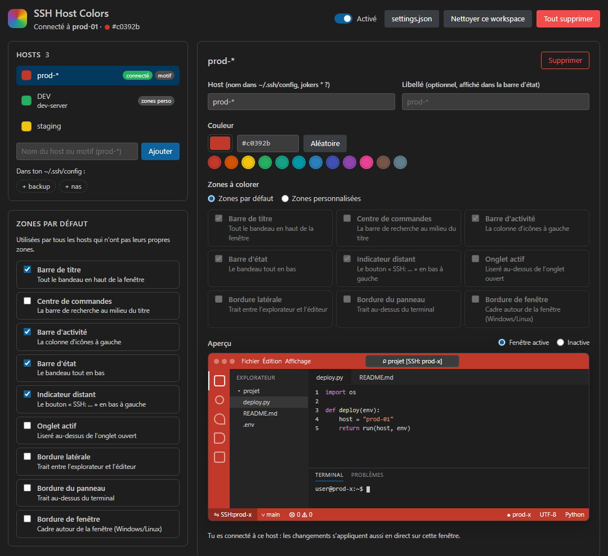
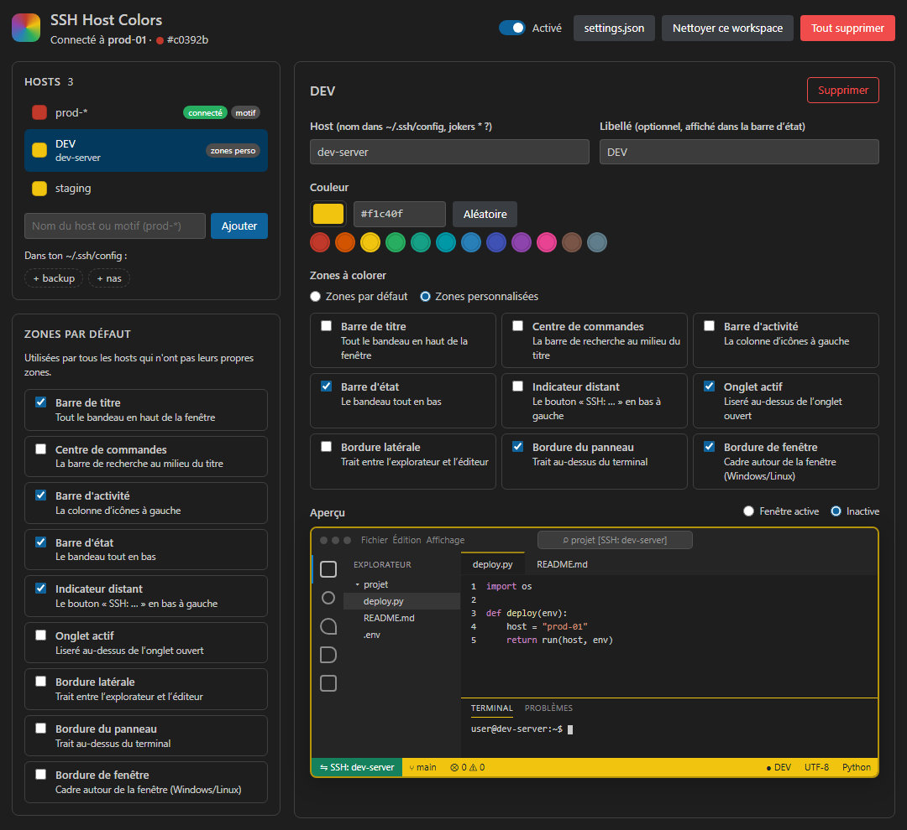

# Host Colors — SSH, WSL, Containers & Folders

[English](README.md) · **Français** · [Deutsch](README.de.md) · [Español](README.es.md) · [Italiano](README.it.md) · [Português (Brasil)](README.pt-br.md) · [Русский](README.ru.md) · [日本語](README.ja.md) · [한국어](README.ko.md) · [简体中文](README.zh-cn.md) · [繁體中文](README.zh-tw.md)

Colore la fenêtre de VS Code selon l'endroit où tu travailles : serveur SSH, distribution WSL, Dev Container, Codespace, Remote Tunnel ou dossier de projet. Pour ne plus jamais confondre la prod et la dev, ni un projet avec un autre.



## Fonctionnalités

- **Gestionnaire graphique** (`Host Colors: Ouvrir le gestionnaire`) :
  - liste de tous tes hosts, et ajout en un clic de ceux de ton `~/.ssh/config`
  - sélecteur de couleur, 12 couleurs proposées, couleur aléatoire
  - **aperçu en direct** dans une fausse fenêtre VS Code (fenêtre active ou inactive)
  - libellé personnalisé (ex. « PROD ⚠ ») affiché dans la barre d'état
  - zones par défaut, ou propres à chaque host
- **9 zones colorables** : barre de titre, centre de commandes, barre d'activité, barre d'état, indicateur distant, onglet actif, bordure latérale, bordure du panneau, bordure de fenêtre.
- **Aperçu sur la vraie fenêtre** : dans `Choisir la couleur` / `Choisir les zones`, survoler une couleur ou cocher une zone l'applique tout de suite. Échap annule.
- **Motifs** : `prod-*` colore tous les hosts qui commencent par `prod-`. Un nom exact passe avant un motif.
- **Tout supprimer** en un clic, plus une commande pour activer / désactiver toutes les couleurs.
- Pastille dans la barre d'état : un clic ouvre le menu rapide.



## Commandes

| Commande | Rôle |
|---|---|
| Ouvrir le gestionnaire | Interface complète avec aperçu |
| Choisir la couleur (aperçu en direct) | Quick pick avec prévisualisation sur la fenêtre |
| Choisir les zones colorées | Pour ce host ou par défaut |
| Activer / désactiver les couleurs | Interrupteur global |
| Supprimer la couleur d'un host | |
| Tout supprimer | Efface tous les hosts et retire les couleurs |
| Nettoyer les couleurs de ce workspace | Retire les couleurs restées bloquées |
| Exporter la configuration… / Importer une configuration… | Partager tes couleurs dans un fichier JSON (fusion ou remplacement à l'import) |

## Au-delà de SSH : WSL, conteneurs et dossiers de projet

Les couleurs fonctionnent aussi dans les autres fenêtres. La clé de l'entrée indique à quoi elle s'applique :

| Clé | Fenêtre |
|---|---|
| `prod-server` | Host SSH (comme dans `~/.ssh/config`) |
| `wsl:Ubuntu` | Distribution WSL |
| `container:mon-app` | Dev Container (nom du dossier ou du conteneur) |
| `codespace:<nom>` / `tunnel:<nom>` | GitHub Codespaces / Remote Tunnel |
| `folder:c:/projets/boutique` | Dossier de projet local |
| `folder:prod-server:/srv/app` | Dossier sur un environnement distant |

- Une entrée de dossier passe avant celle de son environnement : colore tout un serveur, puis donne à un projet sa propre couleur (menu → **Colorer seulement ce dossier**).
- Dans une fenêtre locale, la pastille de la barre d'état n'apparaît que pour les dossiers qui ont une couleur.
- Les jokers restent dans leur type : `*` ne vise que les hosts SSH, `folder:*/api` vise tous les dossiers nommés `api`.

## Langues

L'interface suit la langue d'affichage de VS Code : anglais (par défaut), français, allemand, espagnol, italien, portugais (Brésil), russe, japonais, coréen, chinois simplifié et traditionnel.

## Démarrage rapide

1. Ouvre un dossier, en local ou à distance (SSH, WSL, Dev Container, Codespace…).
2. Fenêtre distante : clique sur la pastille en bas à gauche → **Changer la couleur**. Fenêtre locale : lance **Host Colors: Choisir la couleur (aperçu en direct)** depuis la palette de commandes (la pastille apparaît dès que le dossier a une couleur).
3. Survole les couleurs pour les essayer, puis Entrée.

## Configuration manuelle

```json
"sshHostColors.hosts": {
  "prod-*": "#c0392b",
  "dev-server": { "color": "#27ae60", "label": "DEV", "elements": ["statusBar", "activeTab"] }
},
"sshHostColors.elements": ["titleBar", "activityBar", "statusBar"]
```

## Notes

- Les couleurs sont écrites dans `workbench.colorCustomizations` **au niveau du workspace** (`.vscode/settings.json` sur le serveur), pour ne colorer que la fenêtre connectée. Tes propres personnalisations sont conservées : seules les valeurs posées par l'extension sont retirées.
- Après « Tout supprimer », les fenêtres ouvertes sont nettoyées tout de suite, les autres à leur prochaine ouverture.
- Sans dossier ouvert, VS Code ne permet pas de colorer la fenêtre : seule la pastille s'affiche.
- La barre de titre et la bordure de fenêtre demandent `"window.titleBarStyle": "custom"` (c'est le réglage par défaut sous Windows).
